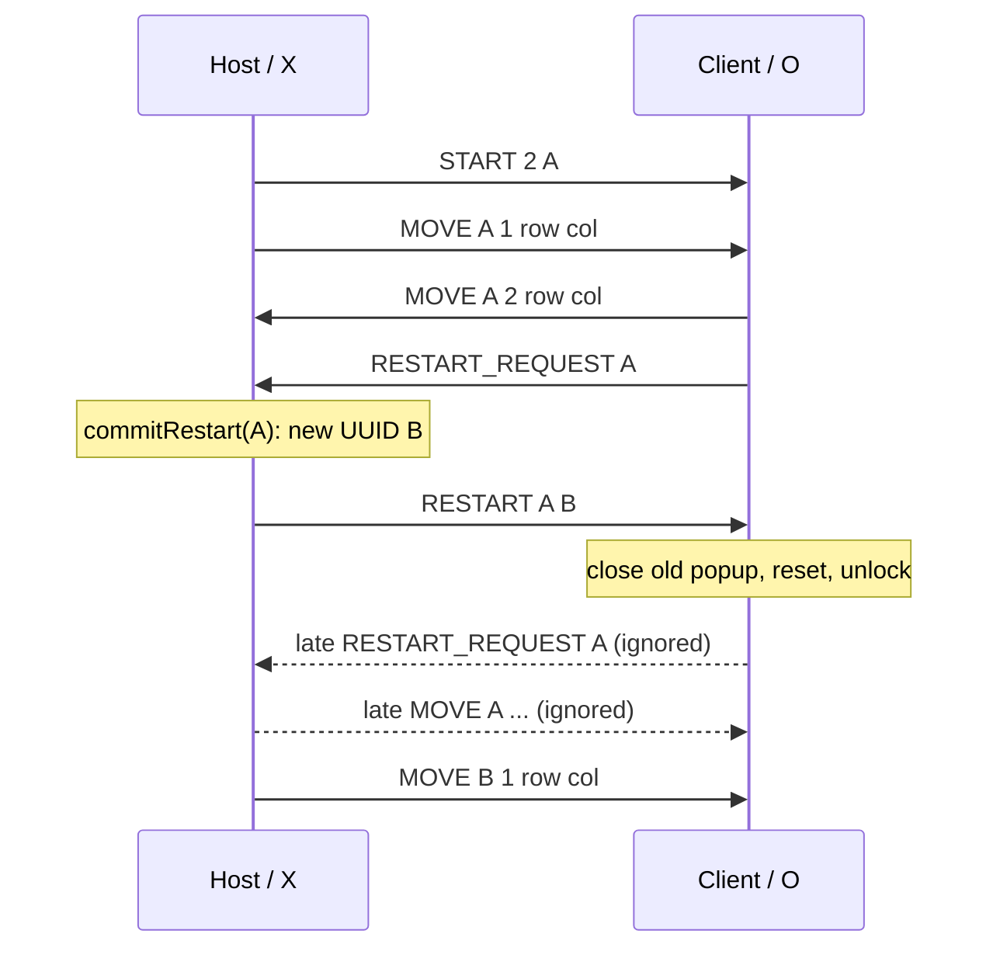

# Task 3.5 — LAN protocol v2

Approved scope: no consent/ACK phase (reserved for Task 5), no DISCONNECT packet.
Closing a session closes its socket; the peer observes EOF.

```text
START 2 <roundId>                     host -> client, UUID per game
MOVE <roundId> <ply> <row> <col>       either side, ply starts at 1
RESTART_REQUEST <baseRoundId>         client -> host
RESTART <baseRoundId> <newRoundId>     host -> client
```

Host/X/black still starts. Odd plies belong to X, even plies to O. Receiver
checks session, round ID, next ply, opponent color/current turn and empty
in-bounds square before modifying the board. UUIDs are not local score gameIds.

Client waits at most 5 seconds for valid START; version mismatch or timeout
closes that session with a VI/EN/PT error. Malformed, missing, oversized
(over 256 characters) or invalid MOVE/restart lines are drained/ignored.
There is no runtime rule selector: Board defaults to the project's RULE_B,
so this protocol does not transmit a ruleId. Both applications must use this
version and that configured rule; test-only Board.setWinRule is not a UI option.

requestRestart is the request phase; commitRestart is host authority. Task 5
can insert consent between these phases without changing MOVE. Requests
targeting the same old base are coalesced: once A becomes B, more requests
for A are ignored. A request actually made against B is a new request.

Client sends once while waiting, locks input, and shows Lang.restartWaiting.
Only RESTART whose base matches its current round is accepted. Round change
and EOF clear waiting. Result popups for the old game are disposed before
reset; late result callbacks and queued victory sounds have game guards.
Already recorded valid results remain, as required by Task 2.


