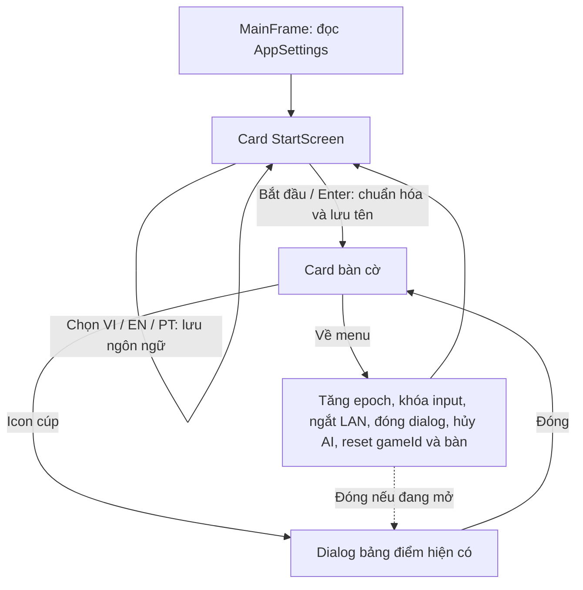

# Task 4 — Màn hình khởi động

MainFrame sở hữu CardLayout với đúng hai card: StartScreen và bàn cờ hiện có.
StartScreen vẽ nền bằng Java2D; không có ảnh ngoài hoặc đường dẫn tuyệt đối.
Icon cúp cũng là Java2D và chỉ biểu diễn bảng điểm thắng/thua/hòa hiện có.

Tên chỉ thuộc máy local: NFC, trim, một dòng, tối đa 16 code point. Khi rỗng,
Lang cung cấp tên mặc định theo VI/EN/PT; không lưu một bản dịch làm tên cố định.
Tên không được đưa vào START/MOVE/RESTART hoặc gửi qua socket. Người chơi PvP
thứ hai vẫn dùng cách gọi hiện có của trò chơi.

Điểm thuộc phiên chạy app, không thuộc tài khoản hay tên. Về menu hoặc đổi tên
giữ điểm. Chế độ chơi và độ khó trở về PvAI/Medium; luật và thuật toán không đổi.
Undo sau thắng/hòa giữ nguyên điều kiện Task 2.

Về menu hủy cả kết nối đang chờ và kết nối đã thiết lập, đóng các dialog sở hữu,
xóa danh tính round LAN và hủy worker. Epoch bảo vệ cả callback đã xếp hàng và
phần tiếp tục sau modal. Bàn cờ bị disable khi card menu hiện, nên click đã xếp
hàng không thể mở một ván ẩn. gameId và cờ enabled cũng bảo vệ âm thanh cũ.

Các test cũ cần thao tác bàn cờ được chuyển card bằng startGame trước khi kiểm;
không bỏ assertion luật/Undo/score/giao thức. Test F4 tiếp tục kiểm bounds bàn
cờ, xuất ảnh vào task4-render/game để giữ nguyên ảnh lịch sử Task 3.5.

Ảnh StartScreen: task4-render/start/{VI,EN,PT}.png và native-{VI,EN,PT}.png.
Test bounds kiểm hai Look & Feel, ba ngôn ngữ, khởi tạo trực tiếp và các chuyển
đổi. Tài nguyên thiết bị thật vẫn cần kiểm tay:

1. Khởi động, nhập tên có dấu hoặc dán tên dài, Enter; về menu, đổi tên/ngôn ngữ,
   bắt đầu lại; đóng/mở app và kiểm tra tên/ngôn ngữ đã lưu.
2. PvAI: về menu trong lúc máy nghĩ; bắt đầu lại và kiểm bàn không tự xuất hiện quân.
3. LAN hai máy: về menu khi chờ kết nối, sau kết nối và khi popup kết quả mở;
   xác nhận đầu kia nhận mất kết nối và có thể tạo phiên mới.
4. Kiểm nút cúp và điểm giữ qua menu/đổi tên; Undo sau thắng/hòa vẫn hoạt động.
5. Âm thanh loa thật và DPI 100%/125%/150%: chữ, nút và hover/click bàn cờ.
